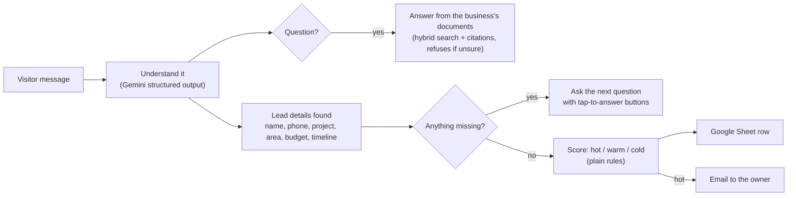

# LeadDesk: a website assistant that answers questions and books qualified leads

A chat bubble for any website. It answers visitors' questions from the business's own documents. When a visitor is interested, it collects their details one question at a time, scores the lead as **hot, warm or cold**, adds it to a **Google Sheet** and **emails the owner about hot leads**.

**Live demo:** _link coming soon_ (the free server sleeps when idle, so the first message can take up to a minute)  
**Built by:** Bharti Shrivastava, AI automation engineer. [Hire me on Contra](https://contra.com/bharti_shrivastava_zu3hypce) to add this to your website.

---

## The problem it solves

Most visitors to a small business website leave without filling in the contact form, and many who do leave half the details. The owner then spends time calling people who were never going to buy.

LeadDesk answers the questions that make people hesitate (prices, areas served, timelines) and turns interest into a complete, scored lead, so the owner calls the hot ones first.

## Try it

There are three demo websites, each for a *fictional* business with its own documents, questions and lead scoring:

- **`/estate`: Harbour & Finch, a Bristol estate agency.** Press "Ask about this home" on any listing, book a viewing as a buyer (it asks about budget, mortgage and chain) or ask for a valuation. Sellers and landlords are always hot leads.
- **`/dental`: Amberwick Dental, a private practice in Leeds.** Ask about fees or nervous patients, or request an appointment. Mention pain or an accident and it gives the practice phone number, NHS 111 and 999 guidance instead of advice, every time.
- **`/`: Terracotta Lane Interiors**, described below.

The interior studio site belongs to **Terracotta Lane Interiors**, a *fictional* interior design studio in Pune. Open the chat bubble and try:

- "How much does a 2 BHK cost?", then **Book a free consultation**
- Everything in one message: *"Hi, I'm Sneha. We need a modular kitchen in Kothrud, budget around 4 lakh, starting within a month. My number is 91234 56789"*
- A visitor from outside the service area, such as an office in Mumbai, which is scored cold and told politely
- A question the documents don't cover, such as "Do you offer EMI?". It says it doesn't know instead of guessing.

Each finished chat becomes one row in the Google Sheet:

| Name | Phone | Project | Area | Budget | Timeline | Lead | Why |
|---|---|---|---|---|---|---|---|
| Priya Kulkarni | +919822012345 | Full home | Baner | ₹6–10 lakh | 1–3 months | HOT | Budget ₹6–10 lakh; Wants to start 1–3 months; Full home |

## Results

<!-- RESULTS:START -->
Measured on 17 Nov 2026.

**Harbour & Finch Estate Agents** (8 scripted visitor conversations and 12 questions)

| | Rules only | Gemini (`gemini-3.5-flash-lite`) |
|---|---:|---:|
| Conversations that ended with a saved lead | 8/8 | 8/8 |
| Lead details captured correctly | 49/49 | 48/49 |
| Lead scored hot / warm / cold correctly | 8/8 | 8/8 |
| Visitor messages per saved lead (average) | 5.9 | 5.9 |
| Questions answered correctly from the documents | 7/9 | 9/9 |
| Declined questions the documents don't cover | 0/3 | 3/3 |

**Amberwick Dental** (8 scripted visitor conversations and 12 questions, plus 8 urgent and advice messages)

| | Rules only | Gemini (`gemini-3.5-flash-lite`) |
|---|---:|---:|
| Conversations that ended with a saved lead | 8/8 | 8/8 |
| Lead details captured correctly | 39/39 | 38/39 |
| Lead scored hot / warm / cold correctly | 8/8 | 8/8 |
| Visitor messages per saved lead (average) | 5.2 | 5.2 |
| Questions answered correctly from the documents | 9/9 | 9/9 |
| Declined questions the documents don't cover | 0/3 | 3/3 |
| Urgent and advice messages given the fixed safe reply | 8/8 | 8/8 |

**Terracotta Lane Interiors** (9 scripted visitor conversations and 11 questions)

| | Rules only | Gemini (`gemini-3.5-flash-lite`) |
|---|---:|---:|
| Conversations that ended with a saved lead | 8/9 | 9/9 |
| Lead details captured correctly | 52/53 | 52/53 |
| Lead scored hot / warm / cold correctly | 8/9 | 9/9 |
| Visitor messages per saved lead (average) | 6.6 | 6.4 |
| Questions answered correctly from the documents | 8/9 | 8/9 |
| Declined questions the documents don't cover | 0/2 | 2/2 |

The rule-based parsers were written alongside these test conversations, so their scores are optimistic. In rules-only mode, questions are answered with the best-matching passage, which is why it never declines.
<!-- RESULTS:END -->

## How it works



- **Answers come from the business's documents.** It reuses the retrieval engine from my document chatbot project, DocAnswer (hybrid keyword and meaning search, answers checked against their sources). If the documents don't cover something, it says so instead of guessing.
- **Gemini reads messy messages** ("max 5 lakhs", "after diwali maybe 2 months", Hinglish) and returns structured fields. Every value is then **checked in code**: Indian mobile numbers, budget and timeline bands, service areas. Phone numbers are always taken from the message itself, never from the model.
- **Scoring is plain, editable rules** (budget, timeline, project type, service area), and every lead row says why it got its score.
- **No lead is lost.** If the Google Sheet can't be reached, the lead is saved to a backup CSV file.
- **Safe to put on a public website:** per-visitor rate limits, message length and per-chat limits, sessions that expire, sheet input protected against spreadsheet formula injection, and a secret token between the server and the sheet.
- **One line to embed:** the widget is a single dependency-free script with its own styles, so it never clashes with the host website.

```html
<script src="https://your-server/widget.js" data-business="estate" data-title="Your business" data-color="#B4552D" defer></script>
```

Built with **FastAPI**, **LangChain** and **Gemini**, plain **JavaScript** for the widget, and a **Google Apps Script** webhook for the Sheet and email alerts. Hosted free on Render.

## Run it on your computer

You need Python 3.10 or newer and a free Gemini API key from [Google AI Studio](https://aistudio.google.com/apikey).

```bash
git clone <this repository's URL>
cd website-lead-assistant
python -m venv .venv
# Windows: .venv\Scripts\activate     macOS/Linux: source .venv/bin/activate
pip install -r requirements-dev.txt
cp .env.example .env        # Windows: copy .env.example .env   then paste your key into .env
python scripts/check_setup.py
uvicorn server.main:app --reload
```

Open http://127.0.0.1:8000 for the demo website, or http://127.0.0.1:8000/docs for the API. Without a key the assistant uses rule-based parsing and shows the best-matching passage instead of a generated answer. Without a Google Sheet, leads go to `leads/interior.csv`.

To send leads to a Google Sheet, follow the five steps at the top of `integrations/google_apps_script.gs`, then put the web app URL and token in `.env`.

```bash
pytest                    # 64 tests, no key needed
python eval/run_eval.py   # rules vs Gemini on scripted conversations
```

## Project structure

```
server/main.py              FastAPI: /api/<business>/chat|greeting|health, /widget.js, demo sites
static/widget.js            the embeddable chat bubble (no dependencies)
static/*.html               demo websites: index (interior studio), estate, dental
leaddesk/
  conversation.py           the chat flow: answer, ask, submit
  extract.py                Gemini structured extraction + rule-based fallback
  fields.py                 questions, choices and validators (phone, budget, timeline, area, name)
  qualify.py                hot / warm / cold scoring
  sinks.py                  Google Sheet webhook, CSV backup
  service.py                sessions, rate limits, error handling
  faq.py                    answers from the business documents
docanswer/                  retrieval engine reused from the document chatbot project
business/                   the studio's documents (services, prices, process)
integrations/               Google Apps Script for the Sheet and email alerts
eval/                       scripted conversations, questions and the evaluation
```

## Limitations

- Chats in progress are kept in the server's memory, so a restart loses unfinished chats (finished leads are already saved). A busy site would use Redis or a database.
- The free Render server sleeps after 15 minutes without visitors; the first message then takes up to a minute. A paid instance removes this.
- Scoring rules and questions are examples for an interior studio; each business sets its own.
- The evaluation uses 9 scripted conversations, which is enough to compare approaches, not a guarantee.

## Want this for your business?

I build website assistants like this for clinics, coaching institutes, real-estate agents, interior designers and other service businesses, connected to your documents, your Google Sheet or CRM, and your own lead rules. [Message me on Contra](https://contra.com/bharti_shrivastava_zu3hypce).

---

MIT licensed. Terracotta Lane Interiors and everything about it is fictional and exists only for this demo.
